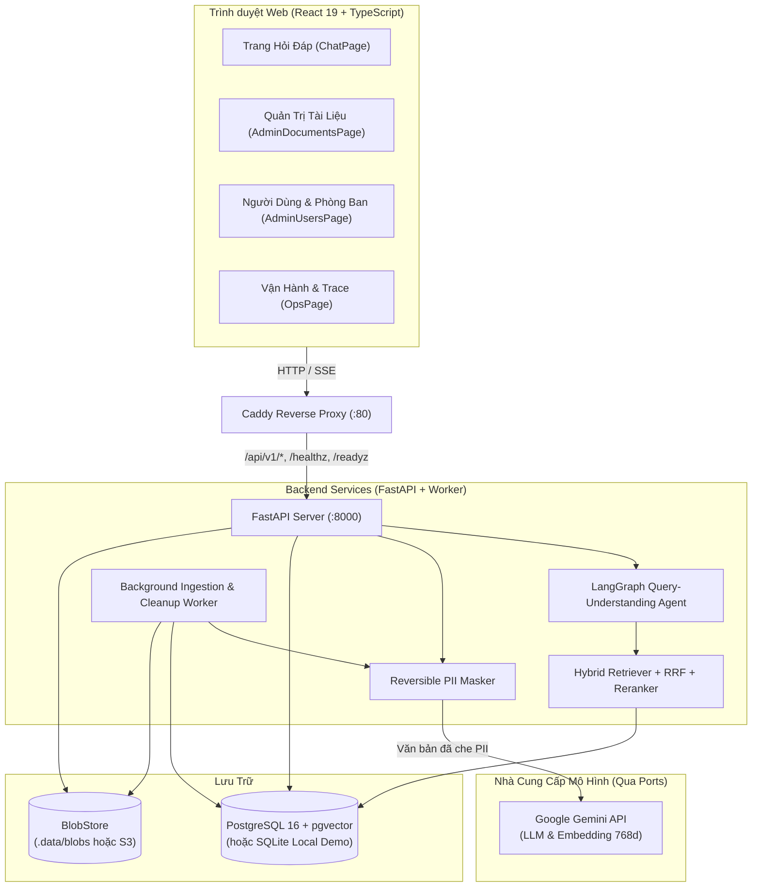
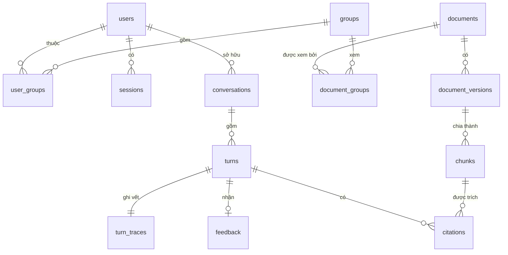

# RAG_Agents — Hệ Thống Hỏi Đáp Tài Liệu Nội Bộ Song Ngữ (VI/EN)

Hệ thống hỏi đáp tài liệu nội bộ song ngữ **Việt – Anh** tích hợp **Query-Understanding Agent (LangGraph)** và **Grounded RAG**, hỗ trợ làm rõ câu hỏi mơ hồ trước khi tra cứu, trích dẫn nguồn chính xác đến từng đoạn/trang, phân quyền chặt chẽ theo phòng ban (RBAC) ngay tại tầng truy vấn SQL, và tự động che thông tin nhạy cảm (PII) trước khi gửi ra dịch vụ mô hình ngôn ngữ bên ngoài.

---

## Mục Lục

1. [Tính Năng Cốt Lõi](#1-tính-năng-cốt-lõi)
2. [Kiến Trúc Hệ Thống](#2-kiến-trúc-hệ-thống)
3. [Cấu Trúc Thư Mục](#3-cấu-trúc-thư-mục)
4. [Luồng Xử Lý Agent & Grounded RAG](#4-luồng-xử-lý-agent--grounded-rag)
5. [Mô Hình Dữ Liệu & Phân Quyền](#5-mô-hình-dữ-liệu--phân-quyền)
6. [Bảo Mật & Che Dữ Liệu Nhạy Cảm (PII)](#6-bảo-mật--che-dữ-liệu-nhạy-cảm-pii)
7. [Hướng Dẫn Cài Đặt & Khởi Chạy](#7-hướng-dẫn-cài-đặt--khởi-chạy)
8. [Cấu Hình Biến Môi Trường](#8-cấu-hình-biến-môi-trường)
9. [Tài Liệu REST API & Giao Thức SSE](#9-tài-liệu-rest-api--giao-thức-sse)
10. [Kiểm Thử & Bộ Đánh Giá Chất Lượng (Eval)](#10-kiểm-thử--bộ-đánh-giá-chất-lượng-eval)

---

## 1. Tính Năng Cốt Lõi

- **Hỏi đáp song ngữ & chéo ngôn ngữ (VI/EN)**: Trả lời đúng theo ngôn ngữ câu hỏi của người dùng ngay cả khi tài liệu gốc được viết bằng ngôn ngữ còn lại.
- **Trích dẫn có căn cứ & xác thực tự động (`Citation Verifier`)**:
  - Câu trả lời được trình bày dạng đoạn văn kèm số trích dẫn `[1]`, `[2]` ngay trong câu.
  - Bước kiểm chứng xác định (`verify_citations`) tự động loại bỏ mọi marker không hợp lệ và đánh số lại liên tục `1..k` theo thứ tự xuất hiện.
  - Hỗ trợ xem đoạn trích gốc (popover) và mở file nguồn tại trang tương ứng.
- **Agent hiểu câu hỏi & làm rõ câu hỏi mơ hồ (`LangGraph`)**:
  - Phân tích ý định (`lookup`, `summarize_document`, `aggregate_unsupported`, `out_of_scope`, `clarification_reply`).
  - Tự động viết lại câu hỏi độc lập (`standalone_question`) và tách câu hỏi con (`sub_questions`) dựa trên lịch sử hội thoại.
  - Khi câu hỏi mơ hồ, Agent hỏi lại tối đa **2 lần** kèm các nút lựa chọn cụ thể; nếu vẫn chưa rõ sau 2 lần, Agent trả lời theo giả định hợp lý nhất và ghi rõ giả định đã áp dụng.
- **Tóm tắt tài liệu đơn lẻ**: Hỗ trợ chế độ `stuff` (với tài liệu $\le 50.000$ token hoặc $\le 12$ đoạn) và `map-reduce` theo từng mục cho tài liệu dài mà vẫn bảo toàn số thứ tự trích dẫn `[n]`.
- **Phân quyền theo phòng ban & vòng đời tài liệu (SQL Pre-filter)**:
  - Áp dụng bộ lọc quyền xem (`is_company_wide` hoặc giao tập phòng ban `user_groups` $\cap$ `document_groups`) trực tiếp trong câu lệnh SQL trước khi tính điểm tương đồng.
  - Tự động loại bỏ tài liệu đã hết hạn (`expires_on < today`) và gắn nhãn cảnh báo *"áp dụng từ ngày..."* với tài liệu chưa đến ngày hiệu lực (`effective_from > today`).
- **Bảo vệ dữ liệu cá nhân (Reversible PII Masking)**:
  - Nhận diện và che CCCD, CMND, Hộ chiếu, Số điện thoại Việt Nam, Email, Số tài khoản ngân hàng, Mức lương, API Secret bằng các placeholder (`<CCCD_1>`, `<PHONE_1>`, ...) trước khi gọi Embedding/LLM hoặc ghi vào log/trace.
- **Quản trị & Vận hành (Admin & Ops)**:
  - Quản lý người dùng, phòng ban, khóa tài khoản khi đăng nhập sai nhiều lần, bắt buộc đổi mật khẩu tạm.
  - Tải lên tài liệu đa định dạng (`PDF`, `DOCX`, `HTML`, `Markdown`), kiểm tra magic bytes, từ chối PDF scan/mật khẩu, quản lý phiên bản nguyên tử (`queued` $\rightarrow$ `processing` $\rightarrow$ `ready` / `superseded`).
  - Thu thập phản hồi người dùng (`helpful` / `not_helpful`), xem chi tiết `turn_traces`, chi phí token/USD, độ trễ `p50`/`p95` và xuất metrics chuẩn Prometheus + OpenTelemetry.

---

## 2. Kiến Trúc Hệ Thống

### Công Nghệ Sử Dụng (Tech Stack)

| Thành phần | Công nghệ |
| :--- | :--- |
| **Backend API** | Python 3.11+, FastAPI, Pydantic v2, SQLAlchemy 2.0 (Async), Alembic |
| **Agent & LLM** | LangGraph, Google Gemini API (`gemini-3.5-flash-lite`, `gemini-embedding-001` 768 chiều), LiteLLM |
| **Tìm kiếm & Xếp hạng** | Hybrid Search (Cosine Similarity + Lexical FTS) + Reciprocal Rank Fusion ($k=60$) + Reranker (`GeminiFlashReranker` / `BilingualHeuristicReranker`) |
| **Cơ sở dữ liệu** | PostgreSQL 16 + `pgvector` (Production) / SQLite `aiosqlite` (Local Demo & Test) |
| **Xử lý tài liệu & Worker** | `pypdf`, `python-docx`, `BeautifulSoup4`, Background Worker (`app.worker`) |
| **Bảo mật & Quan sát** | Argon2id (`argon2-cffi`), Fernet (`cryptography`), `structlog`, OpenTelemetry, Prometheus |
| **Frontend Web** | React 19, TypeScript 5, Vite, TanStack Query, Tailwind CSS |
| **Triển khai** | Docker Compose (`postgres`, `api`, `worker`, `caddy` reverse proxy) |

### Sơ Đồ Kiến Trúc Tổng Thể



---

## 3. Cấu Trúc Thư Mục

```text
RAG_Agents/
├── docker-compose.yml               # Khởi chạy postgres (pgvector), api, worker, caddy
├── Caddyfile                        # Cấu hình reverse proxy & phục vụ SPA frontend
├── .env.example                     # Mẫu cấu hình biến môi trường
├── backend/                         # Backend Python (FastAPI, LangGraph, RAG, Worker)
│   ├── pyproject.toml               # Khai báo dependencies và cấu hình pytest/ruff/mypy
│   ├── Dockerfile                   # Image cho api và worker
│   ├── alembic.ini & alembic/       # Quản lý migration cơ sở dữ liệu
│   ├── prompts/                     # Prompt tập trung có đánh phiên bản (YAML)
│   │   ├── analyze_query.v1.yaml
│   │   ├── grade_evidence.v1.yaml
│   │   ├── generate_answer.v1.yaml
│   │   └── summarize_doc.v1.yaml
│   ├── src/app/
│   │   ├── main.py                  # FastAPI app factory, lifespan, auto-seed cho SQLite
│   │   ├── config.py                # Quản lý cấu hình kiểu tĩnh (pydantic-settings)
│   │   ├── cli.py                   # Lệnh CLI nạp dữ liệu mẫu (seed-demo)
│   │   ├── worker.py                # Tiến trình chạy nền xử lý tài liệu & dọn dẹp định kỳ
│   │   ├── ports/providers.py       # Giao diện trừu tượng: LLMClient, Embedder, Reranker, BlobStore
│   │   ├── adapters/                # Hiện thực GeminiLLMClient, FakeLLMClient, Embedder, Reranker, BlobStore
│   │   ├── agent/                   # Đồ thị trạng thái LangGraph (graph.py) & Read-only Tools (tools.py)
│   │   ├── rag/                     # HybridRetriever, SQL access_filter, citation_verifier, summarizer
│   │   ├── documents/               # Parser (PDF/DOCX/HTML/MD), structural chunker, ingestion_job
│   │   ├── privacy/masker.py        # Nhận diện & ẩn/khôi phục PII tiếng Việt & quốc tế
│   │   ├── auth/                    # Xác thực session cookie, Argon2id, phân quyền RBAC
│   │   ├── conversations/service.py # Điều phối hội thoại, SSE streaming, lưu turn & trace
│   │   ├── ops/                     # Observability (OTel, structlog, Prometheus) & Ops metrics
│   │   ├── db/                      # SQLAlchemy async engine & các model (auth, document, conversation)
│   │   └── api/                     # Các router REST API (/api/v1/*, /healthz, /readyz, /metrics)
│   └── tests/                       # Bộ test unit, integration và contract
├── frontend/                        # Giao diện người dùng & quản trị (React 19 + Vite)
│   ├── package.json
│   ├── src/
│   │   ├── App.tsx                  # Điều hướng tab theo vai trò (Employee, Content Admin, Admin, Ops)
│   │   ├── pages/                   # LoginPage, ChatPage, AdminDocumentsPage, AdminUsersPage, OpsPage
│   │   ├── components/              # ChatStream, ClarificationCard, CitationPopover, ScopeSelector, FeedbackBar
│   │   └── services/                # REST API client (api.ts) & bộ đọc luồng SSE (chatStream.ts)
│   └── tests/                       # Unit test (Vitest) & E2E test (Playwright)
├── eval/                            # Bộ đánh giá chất lượng tự động (Quality Gates)
│   ├── corpus/corpus.yaml           # Định nghĩa kho dữ liệu chuẩn phục vụ đánh giá
│   ├── datasets/                    # Các bộ test case đánh giá (smoke.yaml, full.yaml)
│   ├── baselines/main.json          # Điểm chuẩn baseline để chống hồi quy chất lượng
│   └── src/eval/                    # Runner (runner.py) và các hàm chấm điểm (judges.py)
└── specs/001-bilingual-doc-qa/      # Tài liệu đặc tả yêu cầu, thiết kế dữ liệu và hợp đồng API
```

---

## 4. Luồng Xử Lý Agent & Grounded RAG

### 4.1. Đồ Thị Trạng Thái Agent (`LangGraph`)

Mỗi lượt hỏi của người dùng đi qua đồ thị trạng thái tường minh được định nghĩa tại [`backend/src/app/agent/graph.py`](file:///D:/RAG_Agents/RAG_Agents/backend/src/app/agent/graph.py):

```mermaid
flowchart TD
    START([Bắt đầu lượt hỏi]) --> Analyze["1. analyze_node\nPhân loại ý định, ngôn ngữ, độ rõ ràng\nTạo truy vấn tìm kiếm & câu hỏi con"]

    Analyze -->|intent = out_of_scope\nhoặc aggregate_unsupported| Refuse["refuse_unsupported_node\nTừ chối lịch sự & hướng dẫn phạm vi"]
    Analyze -->|clarity = ambiguous\n& số lần hỏi lại < 2| Clarify["ask_clarification_node\nSinh câu hỏi làm rõ + các nút lựa chọn"]
    Analyze -->|intent = summarize_document| Summarize["summarize_node\nTìm tài liệu theo tên / phạm vi\nTóm tắt stuff hoặc map-reduce"]
    Analyze -->|clarity = clear\n(hoặc đã chạm trần 2 lần hỏi lại)| Retrieve["2. retrieve_node\nHybrid Search (có lọc quyền SQL)\n+ RRF (k=60) + Rerank"]

    Retrieve --> Grade["3. grade_node\nĐánh giá bằng chứng:\nsufficient / partial / insufficient"]
    Grade -->|insufficient & còn vòng truy xuất\n(< MAX_RETRIEVAL_ROUNDS)| Retrieve
    Grade -->|sufficient / partial\nhoặc hết vòng truy xuất| Generate["4. generate_node\nSinh câu trả lời theo ngôn ngữ câu hỏi\n+ Xác thực trích dẫn (verify_citations)"]

    Refuse --> END([Kết thúc lượt])
    Clarify --> END
    Summarize --> END
    Generate --> END
```

### 4.2. Giới Hạn An Toàn Của Agent (Hard Limits)

Agent hoàn toàn **chỉ đọc (read-only)** thông qua 3 công cụ trong [`backend/src/app/agent/tools.py`](file:///D:/RAG_Agents/RAG_Agents/backend/src/app/agent/tools.py) (`search_documents`, `get_document_outline`, `find_documents_by_title`) và tuân thủ giới hạn cứng trên từng câu hỏi:
- Số câu hỏi làm rõ tối đa: `MAX_CLARIFICATIONS_PER_QUESTION = 2`
- Số vòng truy xuất tối đa: `MAX_RETRIEVAL_ROUNDS = 2`
- Số lần gọi LLM tối đa mỗi lượt: `MAX_TURN_LLM_CALLS = 8`
- Ngân sách token đầu vào tối đa: `MAX_TURN_INPUT_TOKENS = 60000`
- Ngân sách chi phí tối đa mỗi lượt: `MAX_TURN_COST_USD = 0.05`

Khi chạm bất kỳ giới hạn nào, cờ `limit_reached = true` được bật và hệ thống trả về kết quả tốt nhất hiện có kèm thông báo cho người dùng.

---

## 5. Mô Hình Dữ Liệu & Phân Quyền

Chi tiết các bảng dữ liệu được định nghĩa trong [`backend/src/app/db/models/`](file:///D:/RAG_Agents/RAG_Agents/backend/src/app/db/models/):



### Quy Tắc Phân Quyền & Vòng Đời Tài Liệu

1. **Vai trò hệ thống (`roles`)**:
   - `employee`: Đặt câu hỏi, xem trích dẫn, mở tài liệu được phép, gửi phản hồi.
   - `content_admin`: Quản lý kho tài liệu (tải lên, cập nhật phiên bản, chỉnh sửa quyền phòng ban/ngày hiệu lực, gỡ tài liệu).
   - `operator`: Xem dashboard vận hành, phản hồi tiêu cực và trace chi tiết đã che PII.
   - `admin`: Toàn quyền quản trị người dùng, phòng ban, tài liệu và vận hành.
   - *Lưu ý*: Khi đặt câu hỏi trên giao diện chat, mọi tài khoản (kể cả `admin`) chỉ truy xuất được các tài liệu mà phòng ban của mình có quyền xem hoặc tài liệu dùng chung toàn công ty.
2. **Điều kiện lọc SQL bắt buộc ([`access_filter.py`](file:///D:/RAG_Agents/RAG_Agents/backend/src/app/rag/access_filter.py))**:
   - `documents.status = 'active'` và `documents.current_version_id IS NOT NULL`
   - `documents.expires_on IS NULL OR documents.expires_on >= current_date`
   - `documents.is_company_wide = true` HOẶC tồn tại nhóm chung đang hoạt động (`groups.deleted_at IS NULL`) giữa `user_groups` và `document_groups`.
   - Khi xóa một phòng ban (soft-delete), tài liệu chỉ thuộc phòng ban đó sẽ trở thành tài liệu "mồ côi" (không ai xem được ngoài trang quản trị), tuyệt đối **không** tự động biến thành tài liệu dùng chung.

---

## 6. Bảo Mật & Che Dữ Liệu Nhạy Cảm (PII)

- **Xác thực & Phiên làm việc**: Mật khẩu băm bằng **Argon2id**; phiên đăng nhập lưu qua cookie `rag_session` (`HttpOnly`, `SameSite=Lax`, thời hạn trượt 8 giờ); khóa tài khoản 15 phút nếu đăng nhập sai 5 lần liên tiếp.
- **Mã hóa cột câu hỏi**: Nội dung câu hỏi gốc trong bảng `turns` được mã hóa đối xứng bằng **Fernet** (`FIELD_ENCRYPTION_KEY`) khi lưu xuống cơ sở dữ liệu.
- **Reversible PII Masking ([`masker.py`](file:///D:/RAG_Agents/RAG_Agents/backend/src/app/privacy/masker.py))**:
  - Tự động phát hiện và thay thế: `EMAIL`, `BANK_ACCOUNT`, `SALARY`, `CCCD` (12 số), `PASSPORT`, `PHONE` (đầu số VN), `CMND` (9 số), `SECRET` (API keys) bằng thẻ `<LOẠI_SỐ>`.
  - Chỉ văn bản đã che PII (`content_masked`) mới được gửi tới dịch vụ Embedding/LLM và lưu vào `turn_traces`.
- **Chống Prompt Injection từ tài liệu**: Tất cả các đoạn trích được đóng gói trong thẻ `<source id="n" document="..." section="...">` và prompt hệ thống bắt buộc coi nội dung bên trong `<source>` thuần túy là dữ liệu tham khảo, bỏ qua mọi chỉ thị điều khiển nằm trong tài liệu.

---

## 7. Hướng Dẫn Cài Đặt & Khởi Chạy

### Yêu Cầu Hệ Thống

- **Python**: $\ge 3.11$ (khuyến nghị dùng `uv` hoặc `venv`)
- **Node.js**: $\ge 20$ (dùng `npm` hoặc `pnpm`)
- **Docker & Docker Compose** *(tùy chọn, nếu chạy với PostgreSQL 16 + pgvector hoặc triển khai toàn bộ stack)*

---

### Cách 1: Chạy Nhanh Chế Độ Local Demo (Không Cần Docker)

Theo mặc định, nếu không cấu hình `DATABASE_URL` sang PostgreSQL, backend sẽ tự động sử dụng **SQLite** (`.data/local_demo.db`) và tự động khởi tạo bảng + nạp sẵn dữ liệu mẫu (`seed_demo_data`) ngay khi khởi động! Nếu chưa cấu hình `GEMINI_API_KEY`, hệ thống tự động dùng `FakeLLMClient` và `FakeEmbedder` để bạn trải nghiệm ngay lập tức mà không tốn chi phí API.

**Bước 1 — Khởi chạy Backend API (Terminal 1):**

```powershell
cd backend
uv sync
uv run uvicorn app.main:app --reload --port 8000
```

**Bước 2 — Khởi chạy Frontend Web (Terminal 2):**

```powershell
cd frontend
npm install
npm run dev
```

Mở trình duyệt tại địa chỉ `http://localhost:5173`.

#### Tài Khoản Mẫu Được Tạo Sẵn

| Tên đăng nhập | Mật khẩu | Vai trò | Phòng ban |
| :--- | :--- | :--- | :--- |
| `admin` | `AdminPass123!` | `admin`, `content_admin`, `operator`, `employee` | Nhân sự, Kỹ thuật |
| `operator` | `OperatorPass123!` | `operator`, `employee` | *(Toàn công ty)* |
| `emp_hr` | `EmployeePass123!` | `employee` | Nhân sự |
| `emp_eng` | `EmployeePass123!` | `employee` | Kỹ thuật |

#### Kho Tài Liệu Mẫu Được Tạo Sẵn

1. **Quy định nghỉ phép** (`Quy_dinh_nghi_phep_v1.pdf`) — Dùng chung toàn công ty, đang hiệu lực.
2. **Bảng lương 2026** (`Bang_luong_2026.docx`) — Giới hạn **chỉ phòng Nhân sự** (`emp_hr` xem được, `emp_eng` không xem được).
3. **Quy định công tác phí** (`Chinh_sach_cong_tac_phi_2027.pdf`) — Dùng chung toàn công ty, ngày hiệu lực trong tương lai (câu trả lời sẽ tự động kèm cảnh báo *"áp dụng từ ngày..."*).
4. **Sổ tay nhân viên** (`So_tay_nhan_vien.md`) — Dùng chung toàn công ty, đang hiệu lực.
5. **Quy định hỗ trợ gửi xe 2024 (Cũ)** (`Quy_dinh_gui_xe_2024.pdf`) — Đã hết hạn (`expires_on` trong quá khứ, tự động bị loại khỏi kết quả tìm kiếm).

---

### Cách 2: Chạy Với PostgreSQL 16 + pgvector & Google Gemini API

```powershell
# 1. Tạo file .env từ mẫu và điền GEMINI_API_KEY
Copy-Item .env.example .env

# 2. Khởi chạy PostgreSQL 16 + pgvector bằng Docker
docker compose up -d postgres

# 3. Chạy migration Alembic và nạp dữ liệu mẫu
cd backend
uv sync
uv run alembic upgrade head
uv run python -m app.cli seed-demo

# 4. Chạy API server và Background Worker (ở 2 terminal riêng)
uv run uvicorn app.main:app --reload --port 8000
uv run python -m app.worker

# 5. Chạy Frontend
cd ../frontend
npm install
npm run dev
```

### Cách 3: Triển Khai Toàn Bộ Stack Bằng Docker Compose

```powershell
# Build frontend tĩnh trước để Caddy phục vụ
cd frontend
npm install
npm run build
cd ..

# Khởi chạy toàn bộ: postgres, api, worker, caddy (:80)
docker compose up -d --build
```

---

## 8. Cấu Hình Biến Môi Trường

Các biến môi trường được quản lý tại [`.env.example`](file:///D:/RAG_Agents/RAG_Agents/.env.example) và [`backend/src/app/config.py`](file:///D:/RAG_Agents/RAG_Agents/backend/src/app/config.py):

| Biến môi trường | Mặc định | Mô tả |
| :--- | :--- | :--- |
| `GEMINI_API_KEY` | `""` | API Key của Google Gemini (rỗng sẽ dùng `FakeLLMClient` / `FakeEmbedder`) |
| `LLM_FAST_MODEL` | `gemini/gemini-3.5-flash-lite` | Model dùng cho bước phân tích câu hỏi & đánh giá bằng chứng |
| `LLM_ANSWER_MODEL` | `gemini/gemini-3.5-flash-lite` | Model dùng cho bước sinh câu trả lời & tóm tắt tài liệu |
| `EMBEDDING_MODEL` | `gemini/gemini-embedding-001` | Model sinh vector embedding |
| `EMBEDDING_DIM` | `768` | Số chiều vector embedding |
| `RERANKER_PROVIDER` | `gemini_flash` | Bộ xếp hạng lại: `gemini_flash`, `local_bge`, hoặc `heuristic` |
| `RERANK_MIN_SCORE` | `0.25` | Ngưỡng điểm rerank tối thiểu để giữ lại đoạn tài liệu |
| `DATABASE_URL` | `sqlite+aiosqlite:///./.data/local_demo.db` | Chuỗi kết nối DB (`postgresql+asyncpg://...` hoặc `sqlite+aiosqlite://...`) |
| `SESSION_SECRET` | *(chuỗi 32 byte)* | Khóa bí mật cho phiên đăng nhập |
| `SESSION_COOKIE_SECURE` | `false` | Đặt `true` khi chạy qua HTTPS |
| `FIELD_ENCRYPTION_KEY` | *(Base64 32-byte key)* | Khóa Fernet dùng để mã hóa cột `turns.question` |
| `MAX_CLARIFICATIONS_PER_QUESTION` | `2` | Số lần Agent được hỏi làm rõ liên tiếp tối đa |
| `MAX_TURN_LLM_CALLS` | `8` | Số lần gọi LLM tối đa trong một lượt hỏi |
| `MAX_RETRIEVAL_ROUNDS` | `2` | Số vòng truy xuất tối đa trong một lượt hỏi |
| `MAX_TURN_INPUT_TOKENS` | `60000` | Tổng số token đầu vào tối đa cho một lượt hỏi |
| `MAX_TURN_COST_USD` | `0.05` | Chi phí ước tính tối đa (USD) cho một lượt hỏi |
| `BLOB_STORE_BACKEND` | `local` | Nơi lưu file gốc: `local` hoặc `s3` |
| `BLOB_STORE_LOCAL_DIR` | `.data/blobs` | Thư mục lưu trữ file khi dùng `local` |
| `MAX_UPLOAD_FILE_BYTES` | `52428800` (50 MB) | Dung lượng tối đa của mỗi file tải lên |
| `MAX_UPLOAD_FILES_COUNT` | `20` | Số lượng file tối đa trong một lần tải lên |

---

## 9. Tài Liệu REST API & Giao Thức SSE

Tất cả các endpoint nghiệp vụ có tiền tố `/api/v1` và trả về header `X-Trace-Id`. Tài nguyên không tồn tại hoặc người dùng không có quyền truy cập luôn trả về mã `404` để chống dò quét sự tồn tại của tài liệu mật.

### 9.1. Danh Sách Endpoint Chính

- **Xác thực (`/api/v1/auth`)**:
  - `POST /auth/login`: Đăng nhập và nhận cookie `rag_session`.
  - `POST /auth/logout`: Đăng xuất và xóa session.
  - `GET /auth/me`: Lấy thông tin người dùng hiện tại, danh sách vai trò và phòng ban.
  - `POST /auth/change-password`: Đổi mật khẩu (tối thiểu 12 ký tự) và thu hồi các session khác.
- **Hội thoại & Hỏi đáp (`/api/v1/conversations`)**:
  - `GET /conversations` & `POST /conversations`: Liệt kê và tạo cuộc hội thoại mới.
  - `GET /conversations/{id}`, `PATCH /conversations/{id}`, `DELETE /conversations/{id}`: Xem lịch sử, đổi tiêu đề/phạm vi tài liệu (`scope_document_id`), hoặc xóa hội thoại.
  - `POST /conversations/{id}/messages`: Gửi câu hỏi hoặc lựa chọn làm rõ (`clarification_choice`) — trả về luồng **Server-Sent Events (`text/event-stream`)**.
  - `POST /conversations/{id}/messages/{turn_id}/cancel`: Hủy lượt sinh câu trả lời đang chạy.
- **Tra cứu Tài liệu & Trích dẫn phía Người dùng**:
  - `GET /api/v1/documents/search?q=...`: Tìm kiếm tài liệu được phép xem theo tiêu đề để chọn phạm vi.
  - `GET /api/v1/citations/{citation_id}`: Xem toàn văn đoạn trích gốc (kiểm tra lại quyền xem tại thời điểm bấm).
  - `GET /api/v1/documents/{id}/file`: Tải hoặc mở trực tiếp file gốc (kiểm tra quyền xem).
  - `PUT /api/v1/turns/{turn_id}/feedback`: Gửi đánh giá `helpful` / `not_helpful` kèm nhận xét.
- **Quản trị Tài liệu (`/api/v1/admin/documents`)** *(Yêu cầu `content_admin` hoặc `admin`)*:
  - `GET /admin/documents` & `POST /admin/documents`: Xem danh sách và tải lên nhiều file cùng lúc kèm cấu hình quyền phòng ban, `effective_from`, `expires_on`.
  - `GET /admin/documents/{id}`, `PATCH /admin/documents/{id}`, `DELETE /admin/documents/{id}`: Xem chi tiết, cập nhật quyền/ngày hiệu lực (áp dụng ngay ở lượt hỏi kế tiếp), hoặc gỡ tài liệu.
  - `POST /admin/documents/{id}/versions`: Tải lên phiên bản mới cho tài liệu.
  - `POST /admin/documents/{id}/versions/{vid}/retry`: Thử xử lý lại phiên bản bị lỗi.
- **Quản trị Người dùng & Phòng ban (`/api/v1/admin/users`, `/api/v1/admin/groups`)** *(Yêu cầu `admin`)*:
  - Tạo/cập nhật người dùng, khóa/mở khóa tài khoản, cấp lại mật khẩu tạm (`reset-password`), thêm/sửa/xóa mềm phòng ban (trả về danh sách `orphaned_document_ids` nếu có).
- **Vận hành & Quan sát (`/api/v1/ops`, `/healthz`, `/readyz`, `/metrics`)**:
  - `GET /api/v1/ops/metrics/summary`: Thống kê tổng hợp độ trễ `p50`/`p95`, TTFT, tỷ lệ lỗi, tỷ lệ không tìm thấy, tỷ lệ hỏi lại, chi phí theo ngày, tỷ lệ phản hồi tích cực.
  - `GET /api/v1/ops/feedback`: Xem danh sách phản hồi của người dùng.
  - `GET /api/v1/ops/turns/{turn_id}/trace`: Xem chi tiết toàn bộ quá trình xử lý lượt hỏi (đã che PII).

### 9.2. Chuỗi Sự Kiện Streaming SSE (`POST /conversations/{id}/messages`)

1. `turn.started`: Trả về `turn_id`, `trace_id`, và `scope_document` đang áp dụng.
2. `status`: Cập nhật trạng thái xử lý (`analyzing` $\rightarrow$ `searching` / `reading_document` $\rightarrow$ `writing`).
3. Nhánh kết quả:
   - Nếu cần hỏi rõ: phát sự kiện `clarification` (chứa câu hỏi làm rõ, danh sách `options`, `remaining_clarifications`).
   - Nếu trả lời / tóm tắt / từ chối: phát liên tiếp các sự kiện `answer.delta` (văn bản kèm marker `[n]`), tiếp theo là sự kiện `citations` (danh sách metadata của từng marker `1..k`).
4. `turn.completed`: Kết thúc lượt hỏi kèm `kind` (`answer`, `partial_answer`, `clarification`, `refusal_not_found`, `refusal_unsupported`, `refusal_out_of_scope`), `answer_language`, `assumptions`, `missing_parts`, `limit_reached`, `latency_ms`.

---

## 10. Kiểm Thử & Bộ Đánh Giá Chất Lượng (Eval)

Dự án đi kèm bộ kiểm thử tự động toàn diện ở cả 3 tầng: Backend (`pytest`), Frontend (`vitest` & `playwright`), và Bộ đánh giá chất lượng RAG/Agent (`eval`).

### 10.1. Chạy Kiểm Thử Backend (Unit, Integration, Contract, Load Test 50 Users)

```powershell
cd backend
uv run pytest
```

Các bài kiểm thử trong [`backend/tests/`](file:///D:/RAG_Agents/RAG_Agents/backend/tests/) bao gồm:
- **Unit tests**: Kiểm tra đồ thị Agent LangGraph, xác thực & đánh số lại trích dẫn (`verify_citations`), thuật toán RRF, ẩn/khôi phục PII tiếng Việt, băm mật khẩu & phân quyền.
- **Integration tests**: Kiểm tra lọc quyền SQL pre-filter giữa các phòng ban, pipeline nạp tài liệu & chuyển đổi phiên bản nguyên tử, phản hồi & trace vận hành, và bài kiểm thử tải **50 người dùng hỏi đáp đồng thời qua SSE** (`test_concurrency_load.py`).
- **Contract tests**: Kiểm tra đúng chuẩn giao thức sự kiện SSE (`test_chat_stream_contract.py`).

### 10.2. Chạy Kiểm Thử Frontend

```powershell
cd frontend
npm test
```

### 10.3. Chạy Bộ Đánh Giá Chất Lượng RAG & Agent (`eval/`)

Bộ công cụ `eval` trong [`eval/src/eval/runner.py`](file:///D:/RAG_Agents/RAG_Agents/eval/src/eval/runner.py) kiểm tra hệ thống trên các kịch bản: hỏi đáp tiếng Việt, tiếng Anh, chéo ngôn ngữ, câu hỏi mơ hồ, câu hỏi một phần, yêu cầu tóm tắt, tài liệu hết hạn/chưa hiệu lực, kiểm thử chống rò rỉ quyền truy cập và chống rò rỉ PII.

```powershell
# Chạy gói smoke hoặc full và so sánh với baseline
uv run --directory backend python -m eval.runner --suite smoke --compare ../eval/baselines/main.json
```

**Các Cổng Chất Lượng Bắt Buộc (Quality Gates):**
- `permission_leak_count == 0` (Không rò rỉ tài liệu khác phòng ban)
- `pii_leak_count == 0` (Không rò rỉ thông tin cá nhân thô ra provider)
- `citation_validity == 1.0` (100% trích dẫn hợp lệ)
- `behavior_accuracy >= 0.90`
- `retrieval_recall_at_8 >= 0.85`
- `answer_correctness >= 0.85`
- `citation_precision >= 0.90`
- `refusal_accuracy >= 0.90`
- `clarify_accuracy >= 0.85`
- `cross_lingual_gap <= 0.10`
